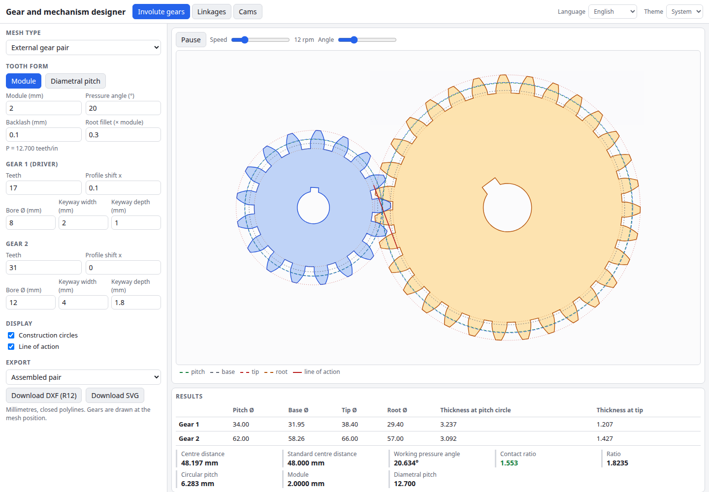

# Gear and Mechanism Designer

Design involute spur gears, analyse linkages and shape disc cams, all in the browser. Mesh gear pairs, ring gears and racks with a live animation, then export the tooth profile as DXF or SVG. Drag the pivots of a four-bar or slider-crank and watch the coupler curve and transmission angle. Build a cam from motion-law segments and see displacement, velocity, acceleration and pressure angle.

**Try it: [hermes98761234.github.io/gear-mechanism-designer](https://hermes98761234.github.io/gear-mechanism-designer/)**

[](https://github.com/hermes98761234/gear-mechanism-designer/actions/workflows/deploy.yml)



## Features

- **Involute spur gears.** Module or diametral pitch, teeth, pressure angle, profile shift, backlash, root fillet, bore and keyway.
- **Meshing animation** for an external pair, an internal ring gear with a pinion, and a rack with a pinion. Centre distance, working pressure angle and contact ratio are computed for the shifted pair, with warnings for undercut, pointed teeth, low contact ratio and an oversized bore.
- **DXF (AutoCAD R12, polylines) and SVG export** in millimetres, for one gear or the assembled pair.
- **Four-bar and slider-crank linkages** with draggable pivots and coupler point, Grashof classification, animation, coupler-curve trace, input range and a transmission-angle plot (plus stroke and quick-return ratio for the slider-crank).
- **Disc cams** with a roller or flat-faced follower. Per segment you pick cycloidal, harmonic, constant-velocity, 3-4-5 polynomial or dwell, plus its duration and lift. You get displacement, velocity, acceleration and pressure-angle plots, an animated follower, undercut and concavity checks, and a DXF or SVG of the profile.
- **English and Ukrainian, light, dark or system theme.** Settings are remembered in the browser. No backend, no tracking.

## How it works

The maths lives in `src/lib` as pure functions with unit tests.

- **Gears.** The flank is the involute of the base circle, `inv(a) = tan(a) - a`. Tooth thickness at any radius comes from the thickness on the pitch circle, `m (pi/2 + 2 x tan a)`. The root fillet is a circular arc found numerically, tangent to both the flank and the root circle. For a pair, the working pressure angle follows from `inv(aw) = inv(a) + 2 (x1 + x2) tan(a) / (z1 + z2)`, and the contact ratio comes from the length of the path of contact. The tests also mesh the outlines at many rotation angles and check that the teeth never interpenetrate.
- **Linkages.** The four-bar closes by intersecting two circles, and the input range comes from sampling the crank angle and refining the limits by bisection.
- **Cams.** Each segment uses a normalised rise law with known boundary conditions. The roller-follower profile is the offset of the pitch curve along the contact normal, and the pressure angle is `tan(phi) = (dy/dtheta - e) / (y + sqrt(Rp^2 - e^2))`. The flat-follower profile comes from the support function `Rb + y`.
- **DXF.** The writer emits an R12 `POLYLINE`/`VERTEX`/`SEQEND` file with layers, and a validator checks the structure in the tests.

The undercut check uses the standard rack limit `z_min = 2 h_a / sin^2(a)`, and the displayed tooth form is a clean involute with a fillet arc, not a simulated hobbing trochoid. Treat the output as a design aid, and check critical gears with your own standards.

## Quick start

You need [Node.js](https://nodejs.org/) 22.

```bash
git clone https://github.com/hermes98761234/gear-mechanism-designer.git
cd gear-mechanism-designer
npm install
npm run dev       # http://localhost:5173
npm test          # geometry, linkage, cam, DXF and i18n tests
npm run build     # static site in dist/
```

## License

MIT
